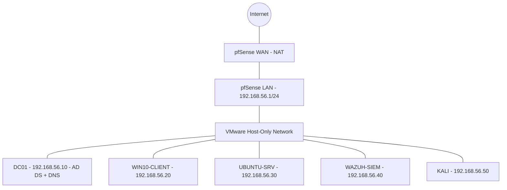

# 🖥️ Project 00: Enterprise Home Lab Setup

## Executive Summary

Built a safe, isolated, virtualized laboratory environment for **Ubuntu Public Services**
(a fictional organization used throughout this portfolio) to practice cybersecurity
skills without risking my personal computer. This is the foundation every other project
in this portfolio builds on top of.

## Lab Network Architecture

- **Host Computer:** Windows 10/11
- **Virtualization:** VMware Workstation Pro (free since Broadcom's license change)
- **Internal Network:** `192.168.56.0/24` (isolated Host-Only network)
- **Domain:** `ubuntupublic.local`

Full IP plan and network diagram: [`architecture/ip-addressing.md`](./architecture/ip-addressing.md)

## Lab Components

| Component | Choice | Why |
|---|---|---|
| Hypervisor | VMware Workstation Pro | Free, stable, snapshotting |
| Gateway/Firewall | pfSense CE | Free, real enterprise firewall, isolates the lab |
| Domain Controller | Windows Server 2022 (eval) | Free 180-day eval, industry-standard AD |
| Client | Windows 10/11 | Target for client-side attacks/detections |
| Linux server | Ubuntu Server 22.04 | Attack surface, later used for web apps |
| SIEM | Wazuh | Free, open-source, real detection pipeline |
| Attacker host | Kali Linux | Pre-loaded with offensive tooling |

## Step-by-Step Build

Full phase-by-phase instructions with exact commands for every VM:
👉 [`build/installation.md`](./build/installation.md)

## Verification Checklist

- [ ] Every VM pings `192.168.56.1` and `192.168.56.10`
- [ ] Every VM resolves `ubuntupublic.local`
- [ ] WIN10-CLIENT logs in as a domain user
- [ ] UBUNTU-SRV reaches the internet via pfSense (`apt update` works)
- [ ] Wazuh dashboard shows 3 active agents
- [ ] A test logon on the client generates Event ID 4624 in Wazuh
- [ ] Your home network is unreachable from KALI
- [ ] Final snapshot `baseline-complete` taken on every VM

Screenshot each check into [`evidence/screenshots/`](./evidence/).

## Business Problem Solved

Testing attacks or security tools against real infrastructure is illegal and dangerous.
This lab provides a legal, isolated sandbox that's realistic enough for findings here to
transfer to real environments, and disposable enough to snapshot and roll back after
every test.

## MITRE ATT&CK Mapping

- Resource Development — Acquire Infrastructure: Virtual Private Server (T1583.003)

## Folder Guide

- [`architecture/`](./architecture/) — IP plan, network diagrams
- [`build/`](./build/) — step-by-step installation guide
- [`security/`](./security/) — hardening, firewall, logging baseline
- [`attacks/`](./attacks/) — simulated attacks run against this lab only
- [`detection/`](./detection/) — what those attacks triggered, and where
- [`evidence/`](./evidence/) — screenshots and log samples
- [`reports/`](./reports/) — technical + executive summary
- [`configs/`](./configs/), [`docs/`](./docs/), [`images/`](./images/) — supporting files

## Lessons Learned

*(fill in after your own build — what differed from the plan, what you'd change)*
