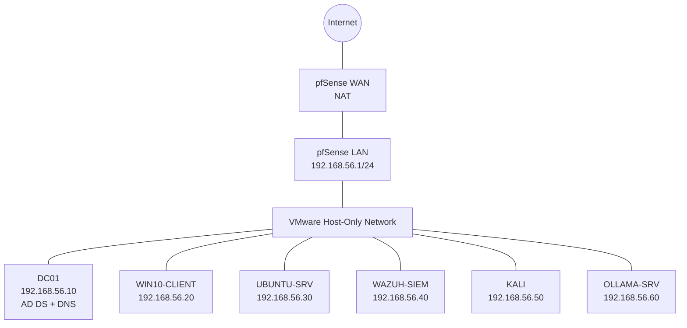

# Master IP Addressing Plan

This is the single source of truth for addressing across the whole portfolio, for the
fictional organization **Ubuntu Public Services**. Every later project (SOC, threat
hunting, forensics, AI deployment, pentest) reuses this lab rather than inventing a new
network, so the IPs here are the IPs you'll see in every other project's diagrams.

## Network

- **Range:** `192.168.56.0/24`
- **Hypervisor networking:** VMware's Host-Only / Internal network, isolated from the
  internet and from your home Wi-Fi
- **VLAN:** none yet (flat network) — VLANs are introduced in Project 09 (Cloud & Zero
  Trust) and Project 14 (Network Security) when the subnet is segmented
- **Why this range:** `192.168.56.0/24` is VMware's conventional Host-Only default,
  private (RFC 1918), and keeps the lab clearly separate from a home router's usual
  `192.168.0.0/24` or `192.168.1.0/24`

## Host table

| Hostname | Role | IP | OS | Built in |
|---|---|---|---|---|
| PFSENSE | Gateway / firewall / DHCP / DNS relay | 192.168.56.1 | pfSense CE | Project 00 |
| DC01 | Domain Controller, AD DS, DNS | 192.168.56.10 | Windows Server 2022 | Project 00 |
| WIN10-CLIENT | Domain-joined workstation | 192.168.56.20 | Windows 10/11 | Project 00 |
| UBUNTU-SRV | Linux server (web/file target) | 192.168.56.30 | Ubuntu Server 22.04 | Project 00 |
| WAZUH-SIEM | SIEM manager + dashboard | 192.168.56.40 | Ubuntu Server 22.04 | Project 00 / 08 |
| KALI | Attacker / tooling box | 192.168.56.50 | Kali Linux | Project 00 |
| OLLAMA-SRV | Private AI host | 192.168.56.60 | Ubuntu Server 22.04 | Project 22 |
| DHCP pool | Reserved for ad-hoc VMs | 192.168.56.100–200 | — | — |

## Conventions used in every project

- Static IPs for anything that's a server or detection target; DHCP reservations are fine
  for throwaway attacker tooling.
- DNS is always `192.168.56.10` (the DC) unless a project explicitly tests DNS failure.
- Gateway is always `192.168.56.1`.
- Subnet mask is always `/24` (`255.255.255.0`) for this flat network.
- Active Directory domain: `ubuntupublic.local`

## Network diagram

Every project folder's own `architecture/` directory links back here instead of repeating
the table, so if an IP ever changes it only has to change in one place.
